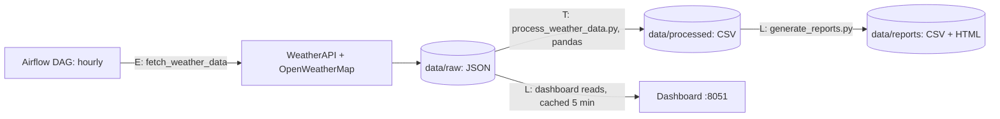
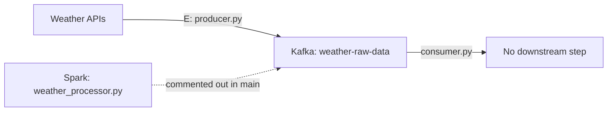

# Reference architecture: WeatherFlow

Labels: E = extract, T = transform, L = load. Each arrow is labelled from the code.

## Scheduled pipeline (Airflow, every hour)

## Separate path (not run by Airflow)

